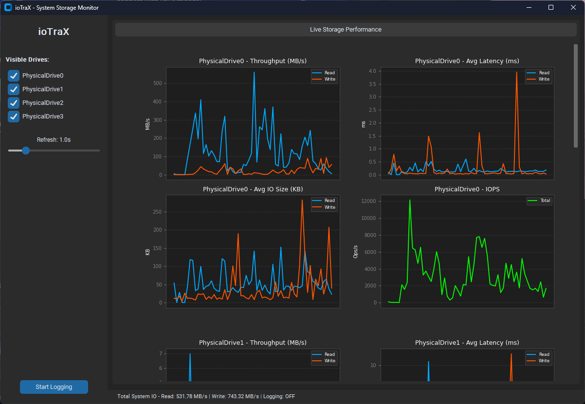

# ioTraX



A lightweight Windows disk I/O monitoring tool built with Python. Track real-time performance metrics for all physical storage devices with a live GUI and per-drive CSV logging.


## Features

- **Per-Drive Live Graphs** — Individual real-time plots for every physical drive detected on the system:
  - Throughput (Read/Write MB/s)
  - Latency (Read/Write ms)
  - Average IO Size (Read/Write KB)
  - IOPS (combined ops/sec)
- **High-Resolution Latency** — Latency is sourced from the Windows PDH API (`Avg. Disk sec/Read` / `Avg. Disk sec/Write`), providing true sub-millisecond floating-point precision. Falls back to psutil counters if PDH is unavailable.
- **Per-Drive CSV Logging** — Clicking "Start Logging" opens a folder picker. One CSV file is created per physical drive, named `io_log_<timestamp>_<drive>.csv`. All values are written at full float precision. Data is flushed to disk on every sample interval so no data is lost on unexpected exit.
- **Drive Visibility Toggle** — Sidebar checkboxes to show/hide individual drives.
- **Adjustable Refresh Rate** — Polling interval slider from 0.1s to 5.0s.
- **Dark UI** — Built with CustomTkinter.

## Requirements

- Windows 10/11
- Python 3.8+
- Run as **Administrator** for accurate disk counter access

Install dependencies:

```bash
pip install psutil matplotlib customtkinter pywin32
```

> `pywin32` is required for high-resolution latency via the Windows PDH API.

## Usage

```bash
# Run as Administrator for full counter access
python ioTraX.py
```

1. All detected physical drives appear in the sidebar with checkboxes — uncheck any to hide its graphs.
2. Use the **Refresh** slider to set how often metrics are polled (default 1.0s).
3. Click **Start Logging** → choose a folder → one CSV per drive begins writing immediately.
4. Click **Stop Logging** to close all files cleanly.

## CSV Output

Each log file covers one drive and contains the following columns:

| Column | Unit | Notes |
|---|---|---|
| Timestamp | YYYY-MM-DD HH:MM:SS | Sample time |
| Read MB/s | MB/s | Throughput since last sample |
| Write MB/s | MB/s | Throughput since last sample |
| Read Latency ms | ms | PDH `Avg. Disk sec/Read` × 1000 |
| Write Latency ms | ms | PDH `Avg. Disk sec/Write` × 1000 |
| Read Size KB | KB | Average read transfer size |
| Write Size KB | KB | Average write transfer size |
| IOPS | ops/sec | Combined read + write ops |

Files are named: `io_log_<unix_timestamp>_<drive>.csv`

Example for a 4-drive system:
```
io_log_1740000000_PhysicalDrive0.csv
io_log_1740000000_PhysicalDrive1.csv
io_log_1740000000_PhysicalDrive2.csv
io_log_1740000000_PhysicalDrive3.csv
```

## Metrics Reference

- **Throughput (MB/s)** — Raw bytes transferred divided by elapsed time. Reflects actual bandwidth to/from the storage device.
- **Latency (ms)** — Average time per completed operation as reported by the Windows PDH performance counters. Sub-millisecond values are expected on modern SSDs/NVMe.
- **Avg IO Size (KB)** — Bytes per operation. Large values indicate sequential workloads; small values indicate random access patterns.
- **IOPS** — Total read + write operations per second. A key indicator of random I/O capability.

## License

MIT License — see LICENSE for details.
